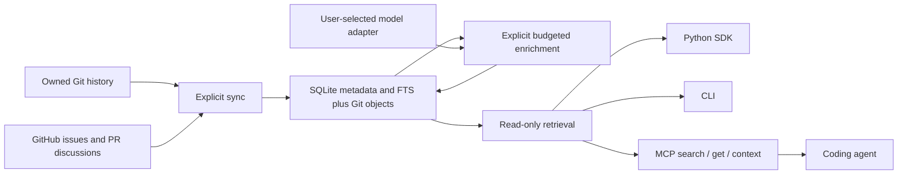

# CodeContext: implementation-ready project memory plan

Updated 2026-10-16. Status: researched design and implementation specification; the library has not been implemented.

Build a local Python library that preserves a project's code, history, discussions, and documented decisions, then gives agents fast access to the evidence relevant to their task. Deliver it as an SDK, a CLI, and a read-only MCP server. The library owns collection, indexing, provenance, and retrieval; an optional user-selected model performs budgeted extraction ahead of queries.

The product succeeds when an agent can explain **what changed, the documented reason, rejected alternatives, conflicting evidence, and whether that reason is established for the selected revision**, with inspectable sources. It must also recognize when the reason is unavailable. Complete access to history cannot recover intent that nobody recorded, deleted discussion versions that were never captured, or inaccessible Git objects.

This plan incorporates the architecture and validation review. It is split into contracts and a 23-task workbook so a lower-cost implementation model can work one bounded task at a time without inventing the interfaces between tasks.

## Read and implement in this order

| Document | What it fixes |
| --- | --- |
| [00 — Shared contracts](docs/plan/00-contracts.md) | Scope, dependency choices, IDs, time/path semantics, requests, errors, budgets, workspace behavior, evidence rules |
| [07 — Exact public models](docs/plan/07-public-models.md) | Nested response types, record union, citation anchors, reports, IDs, cross-field validation |
| [01 — Storage and consistency](docs/plan/01-storage-and-consistency.md) | Concrete SQLite schema, FTS triggers, transactions, invalidation, retention, export |
| [02 — Ingestion and lineage](docs/plan/02-ingestion-and-lineage.md) | Safe Git commands, GitHub endpoint matrix, pagination, syntax extraction, original-to-current mappings |
| [03 — Enrichment and retrieval](docs/plan/03-enrichment-and-retrieval.md) | Model protocol, extraction schema, budget accounting, ranking, traversal, packing, cited summaries |
| [04 — SDK, CLI, and MCP](docs/plan/04-sdk-cli-mcp.md) | Public operations, flags, errors, three MCP tools, resources, setup, actual agent workflow |
| [05 — Validation and benchmarks](docs/plan/05-validation-and-benchmarks.md) | Twelve fixture families, unit/integration checks, human evaluation, evaluation runner, scale/cost measurements |
| [06 — Implementation workbook](docs/plan/06-implementation-workbook.md) | Module/file ownership, T01–T23 dependencies, task recipes, done conditions, handoff prompt, release checklist |

`00` owns shared behavior; `07` owns exact result shapes; the subject chapter owns its algorithm. If an implementation exposes a conflict, correct the affected specification and tests together before proceeding. Do not silently choose a different contract. Read the full bundle once when beginning implementation; afterward, load the current task and its referenced sections.

## What agents use

Yes: MCP is the primary integration for an existing tool-capable coding agent. It is an adapter over the same library used by Python applications and the CLI. It does not require building a new agent runtime.

Expose only three tools:

- `search`: locate code, discussions, decisions, or summaries and return stable expansion handles.
- `get`: open an exact record, source version, code anchor, or coverage gap with citations and pagination.
- `context`: assemble a compact, budgeted pack for a question and optional exact code target.

Expose store status/coverage as a resource. Collection, model enrichment, export, and purge remain explicit SDK/CLI operations. Reads never crawl GitHub, invoke a model, parse missing syntax, or modify durable data. This keeps agent queries predictable in latency, cost, and side effects.

The agent workflow is: find a target, request its context, inspect decisive or conflicting sources, then answer or edit using those findings. Every response identifies the prepared revision, coverage, uncertainty, and configured workspace divergence. An agent can expand original review code even when the current implementation differs. MCP tool availability alone is not proof the agent uses it well; the early real-client milestone and later evaluation test actual adoption.

The source store is the durable memory. Decision claims and summaries are disposable derived views with dependency tracking. A compact result pack is assembled for the current question; no agent must ingest an entire repository wiki before asking a useful question.

## Accepted scope and decisions

| Area | Release decision | Reason and consequence |
| --- | --- | --- |
| Deployment | Local Python package, Linux/macOS, Python 3.12/3.13 | One process and local files are enough to prove the product. Windows is a later tested capability. |
| Source providers | Local Git and GitHub.com | Collect all accessible configured refs/issues/PRs; explicit allowlist for one-hop linked external issues. Other hosts use future collectors. |
| Code languages | Python, JavaScript, TypeScript, JSX, TSX syntax; text/history elsewhere | Tree-sitter supplies syntax facts. No claim of compiler-complete dynamic call graphs. |
| Scale target | Approximately 1M current source lines and 100k commits | Test sparse history storage and bounded retrieval at this scale; do not promise an unmeasured indexing duration. |
| Store | Owned bare Git plus SQLite/FTS5 | Git preserves original objects; SQLite supports metadata, typed relationships, transactions, and lexical retrieval without another service. |
| Snapshot | One active prepared revision per store | Historical records remain expandable; preparing another branch is explicit. Multiple concurrent branch views use separate stores. |
| Parsing identity | Unique blob + language + extractor fingerprint | Unchanged functions are not duplicated for every commit. Paths/commits are occurrence anchors. |
| Enrichment | Optional injected local/cloud model, explicit run budgets | No provider lock-in or implicit paid calls. No model needed for ordinary search/source expansion. |
| Retrieval | Exact identifiers + FTS5 + typed bounded expansion | Measure this baseline before considering embeddings, rerankers, or graph infrastructure. |
| Memory presentation | Exact source anchors, typed decision records, cited group summaries, task context packs | Fast progressive access, uncertainty preserved, evidence expandable. |
| Workspace | Detect HEAD/index/raw-file divergence; no transient parsed overlay | Warn accurately about staged/unstaged/untracked code without silently substituting stale anchors. |
| Intent and applicability | Separate support, lifecycle, mapping, and applicability | Exact code correspondence does not prove a historical reason remains a current requirement. |
| Quality proof | Human-reviewed historical explanations, same-source comparison, completeness and abstention | Citation precision alone can hide incomplete answers. |

These are deliberate v1 boundaries, not proposals for an unbounded platform. Deferred capabilities include hosted multi-tenant service, HTTP MCP hosting, embeddings, compiler-backed cross-language resolution, IDE overlays, autonomous monitoring, arbitrary web crawling, provider adapters in core, and UI dashboards. Add one only after evidence demonstrates a concrete requirement.

## What the review changed

| Review concern | Required design correction | Verification |
| --- | --- | --- |
| Plausible historical reason mistaken for current rule | Separate support/lifecycle/mapping/applicability; corroboration needs explicit revision/scope evidence | F05, U08/U09, E05 |
| Review comments attached to obsolete code | Preserve original review anchor, observed PR head, and target revision separately; candidate mappings stay candidates | F02/F04, I04 |
| Storage grows as every symbol times every commit | Blob-owned extraction, changed-path/hunk history, one active path map | P01/P04 |
| MCP added too late to discover unusable outputs | Real SDK/CLI/MCP story by T11 | I06, E07 |
| Agent edits a dirty checkout using clean historical assumptions | Compare workspace HEAD, staging area, and bounded raw bytes; report divergence | F07, I07 |
| Output is concise but misses a decisive constraint | Weighted required-fact recall, critical facts, counterevidence, answerable success | E02/E05 |
| Improvement comes only from more source access | Same frozen source bytes and identical agent model/budgets for all arms | E03/E08 |
| First useful result takes full backfill | Focus-first fair scheduling, resumable collection, partial coverage | I02, P05 |
| Source edits/deletion leave misleading memories | Dependency invalidation; purge deletes all transitive derived text and checks access epoch | I09/I10 |
| Interfaces are underspecified for a smaller model | Exact types, SQL, endpoint matrix, algorithms, task order, test IDs, handoff record | T02/T03 and every task's done condition |

The final consistency review also fixed duplicate PR identities, safe fsmonitor/filter handling, non-UTF-8 target paths, durable episode inspection coverage, portable export bindings, and a separate agent-evaluation runner. These belong in the implementation contract, not unwritten assumptions for the coder.

## Milestones and release gates

The [workbook](docs/plan/06-implementation-workbook.md) contains the detailed recipes. This is the delivery order:

1. **T01–T05: reliable local foundation.** Lock dependencies, validate models, install the SQLite schema, own Git objects safely, prepare one snapshot, extract syntax once per unique blob.
2. **T06–T11: first useful agent experience.** Collect focused history and discussion, retrieve exact evidence, detect workspace divergence, extract one budgeted decision, and demonstrate it through a real MCP client.
3. **T12–T18: complete declared history and correctness.** Full Git/GitHub backfill, incremental edits and reconciliation, difficult review mappings, complete enrichment scheduling, temporal eligibility, recursive invalidation/access/purge.
4. **T19–T20: project orientation and portability.** Evidence-linked package/directory/project summaries and offline exports whose source anchors survive loss of the original checkout.
5. **T21–T23: prove value and prepare release.** Human-reviewed same-source evaluation, load/latency/cost evidence, supported-platform CI, packaging, and documentation.

The implementation can progress when an external gate is pending, provided its code and deterministic checks pass and the missing gate is recorded. A real client transcript, independently reviewed gold answers, authorized model evaluation, and a reference-machine load report are release evidence. A coding model must not certify those from synthetic tests or its own confidence.

The initial pilot uses 120 questions across pinned Django, Vite, and Requests snapshots, with 40 development and 80 held-out questions grouped by related change family. Targets include at least 54/60 complete successes on answerable held-out questions and correct abstention on at least 19/20 unsupported questions, alongside citation, completeness, counterevidence, and applicability measures. Report sample sizes and uncertainty; these are pilot gates, not a general accuracy guarantee.

Warm local read targets are p95 below 100 ms for `get`, 300 ms for `search`, and one second for `context`, on the declared reference machine and realistic query distribution. Measure truncation and usefulness alongside latency. Measure full backfill, first cited rationale, incremental cost, storage, memory, API calls, and enrichment cost separately. These are unverified targets until the implementation is benchmarked.

## Research informing the choices

The research supports a narrow hypothesis: retrieving relevant development history can help answer project questions, but history alone does not ensure correctness or universal improvement. The specific contracts and thresholds in this plan are engineering decisions to test.

| Primary source | What it informs here | What it does not establish |
| --- | --- | --- |
| [RepoMem](https://arxiv.org/html/2510.01003v2) | Historical development memory is worth evaluating; retrieval relevance matters, and a lexical baseline deserves measurement | Universal gains, undocumented intent, or this product's 100k-commit scale |
| [GraphRAG paper](https://arxiv.org/abs/2404.16130) | Hierarchical summaries can help corpus-level orientation | A requirement for a graph server, or correctness of code-history explanations |
| [RepoQA](https://arxiv.org/abs/2406.06025) | Code retrieval needs a separate measurable evaluation | Historical rationale, decision lifecycle, or current applicability accuracy |
| [Git object batches](https://git-scm.com/docs/git-cat-file), [tree listing](https://git-scm.com/docs/git-ls-tree), [raw diffs](https://git-scm.com/docs/git-diff-tree) | Length-framed objects, byte paths, parent-specific history, reproducible anchors | Reliable logical identity across every edited move or squash |
| [GitHub PR API](https://docs.github.com/en/rest/pulls/pulls), [review comments](https://docs.github.com/en/rest/pulls/comments), [pagination](https://docs.github.com/en/rest/using-the-rest-api/using-pagination-in-the-rest-api) | Source types, original/current review anchors, pagination and endpoint limits | Access to deleted bodies or complete original review objects in every repository |
| [SQLite FTS5](https://www.sqlite.org/fts5.html) | Local lexical retrieval and maintained external-content indexing | The quality of this plan's ranking without evaluation |
| [Tree-sitter Python binding](https://github.com/tree-sitter/py-tree-sitter), [SCIP schema](https://github.com/scip-code/scip/blob/main/scip.proto) | Syntax extraction now, distinction from richer compiler-backed relationships | Full semantic call resolution from syntax alone |
| [Official MCP Python SDK](https://github.com/modelcontextprotocol/python-sdk), [SDK getting started](https://py.sdk.modelcontextprotocol.io/get-started/) | Typed local tools/resources and transport tests | Universal agent adoption or identical behavior across hosts |

Exact dependency candidates and package links appear in contracts §2/§10. Installation/ABI checks are T01 work. A package appearing in an official listing does not prove that the complete chosen stack interoperates.

## Operating boundaries and remaining risks

All accessible configured history means declared refs and provider records visible during the recorded observation window. Reflogs, unavailable objects, unseen prior comment edits, inaccessible sources, and unsupported syntax remain explicit gaps. Full crawling takes API quota and disk; model enrichment takes additional budget. Neither has a credible universal duration or cost estimate before measurement.

Source content is untrusted data. The library does not execute project code, hooks, filters, builds, or instructions from comments. Runtime credentials are excluded from storage/model inputs/exports. Private source bytes and secrets already present in Git history remain evidence: a full export is not an automatically sanitized public artifact. Users choose local versus cloud enrichment explicitly. Local archives cannot prove live remote permission while offline, and previously copied results/exports cannot be recalled by purge.

The hardest remaining quality risk is a well-cited but incomplete explanation, followed by an agent treating historical rationale as a current constraint. Exact byte citations solve provenance, not semantic truth. Human-reviewed evaluation and actual agent transcripts are therefore required alongside parser/storage tests.

## Starting implementation with a lower-cost model

Use the [copyable task prompt and progress template](docs/plan/06-implementation-workbook.md). Start with T01. Create `docs/implementation-status.md` when implementation begins and record completed checks, pending external gates, changed decisions, and the next task after every session. Keep task state on disk rather than relying on chat memory.

Implement one task, verify its stated behavior, repair regressions, and then proceed. Do not ask one model response to implement the whole bundle. This plan removes many design choices from the implementation step; it cannot guarantee that any model will produce correct code without review and tests.

## Checks performed on this plan

The planning pass checked local Markdown links and fenced blocks, parsed JSON examples and the combined Python result-model declarations, executed the planned SQL in an in-memory SQLite database, and verified FTS insertion/update/deletion plus foreign-key integrity. These are document/schema checks only. No package was installed, no library runtime was built, and no MCP compatibility, model-quality, or scale target has been measured. T01 begins dependency installation and interoperability checks.
